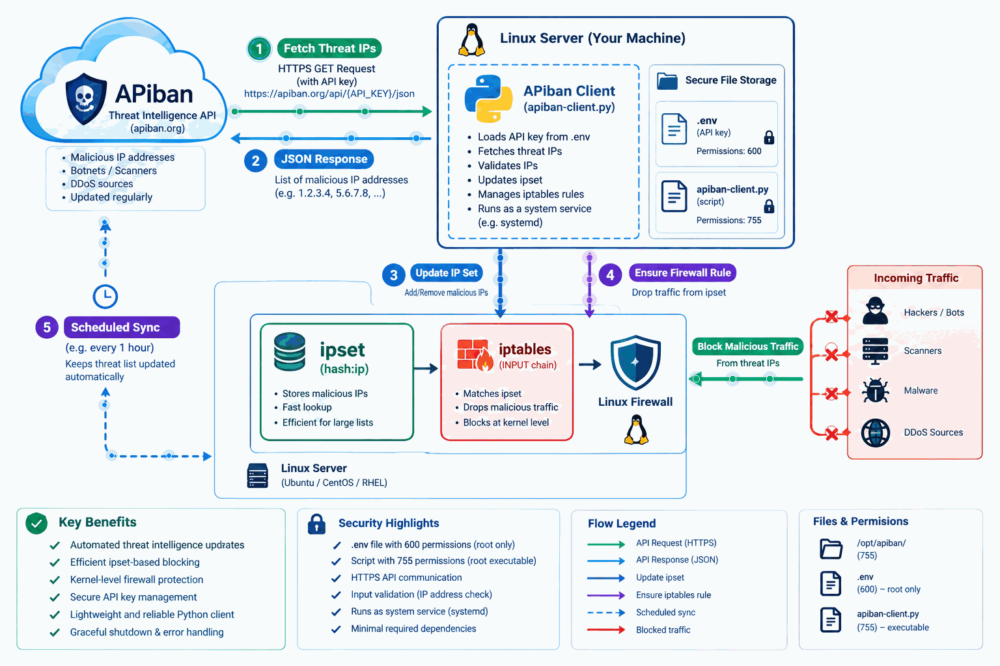
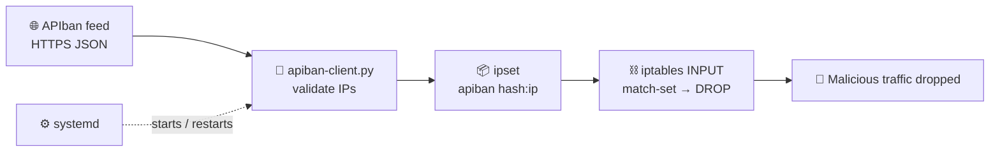
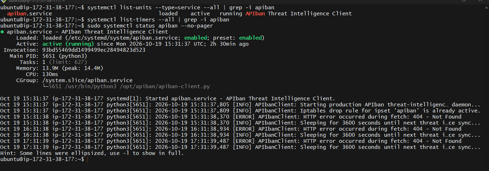
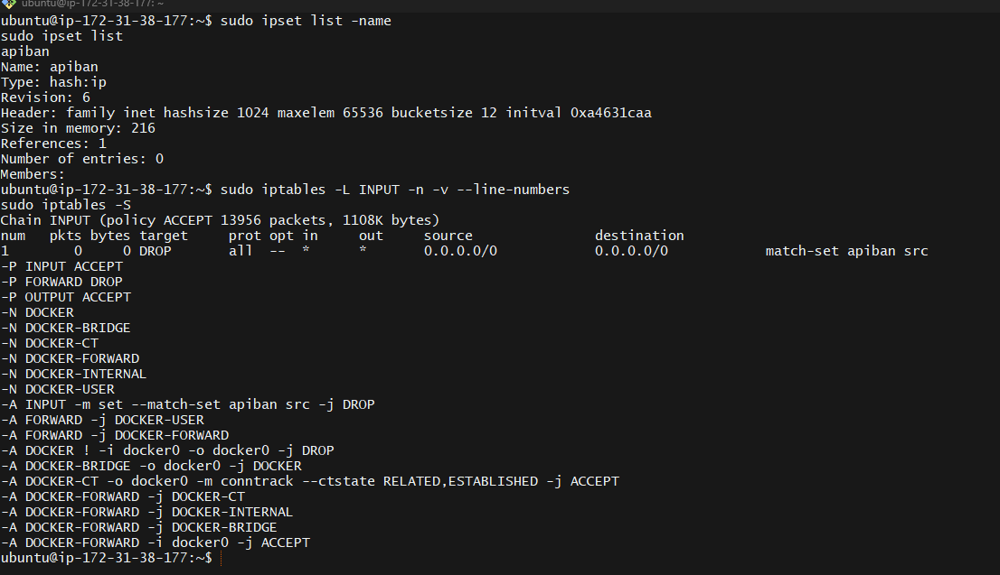

<div align="center">

# 🚧 APIban Threat Feed Client

**Pull malicious IPs from the APIban threat feed and drop their traffic with `ipset` + `iptables`.**


[Quick Start](#-quick-start) •
[How It Works](#-how-it-works) •
[Operations](#-verification-and-operations) •
[Limitations](#-security-and-limitations) •
[Troubleshooting](#-troubleshooting)

</div>

---

A Linux systemd service that retrieves malicious IP addresses from the APIban threat feed and blocks matching source traffic with `ipset` and `iptables`.

> [!NOTE]
> It is intended to complement local detection tools such as Fail2ban, but it can also run as a standalone component.

## 📑 Contents

- [Architecture](#-architecture)
- [How It Works](#-how-it-works)
- [Requirements](#-requirements)
- [Quick Start](#-quick-start)
- [Verification and Operations](#-verification-and-operations)
- [Security and Limitations](#-security-and-limitations)
- [Troubleshooting](#-troubleshooting)
- [Project Files](#-project-files)

---

## 🏗️ Architecture

<div align="center">



</div>

The client connects to the APIban HTTPS endpoint, reads the `ip` array from its JSON response, validates each address, and adds valid entries to the local `apiban` ipset. An INPUT-chain rule drops packets whose source address matches that set. systemd starts the client and restarts it if it exits.



<div align="center">



*Example: APIban service status*



*Example: firewall enforcement status*

</div>

---

## 🔄 How It Works

| Step | What happens |
| :---: | --- |
| **1** | The client loads `APIBAN_API_KEY` from `/opt/apiban/.env`. |
| **2** | It creates the `apiban` `hash:ip` set if needed and checks for the corresponding iptables drop rule. |
| **3** | It requests `https://apiban.org/api/<API_KEY>/json` over HTTPS. The response is expected to be JSON containing an `ip` list. |
| **4** | Each address is validated with Python's `ipaddress` module and passed to `ipset`. |
| **5** | The process waits one hour and repeats. Each HTTP request has a 15-second timeout. |

---

## 📋 Requirements

- ✅ Ubuntu/Debian or a compatible Linux distribution with systemd
- ✅ Python 3 and `python3-dotenv`
- ✅ `ipset` and `iptables`, with a firewall setup compatible with the configured INPUT rule
- ✅ An APIban API key and outbound HTTPS access to `apiban.org`

> [!IMPORTANT]
> The service runs as **root** because it changes kernel firewall state. The implementation is intended for **IPv4** blocking with `ipset`/`iptables`; it does not configure IPv6 firewall enforcement.

---

## 🚀 Quick Start

### Step 1 · Install files

Run from this repository directory:

```bash
sudo apt update
sudo apt install -y python3 python3-dotenv ipset iptables
sudo install -d -o root -g root -m 755 /opt/apiban
sudo install -o root -g root -m 755 apiban-client.py /opt/apiban/apiban-client.py
sudo install -o root -g root -m 644 apiban.service /etc/systemd/system/apiban.service
sudoedit /opt/apiban/.env
```

### Step 2 · Add your API key

Put the key in `/opt/apiban/.env`:

```env
APIBAN_API_KEY=your_actual_api_key
```

### Step 3 · Secure the file and start the service

```bash
sudo chown root:root /opt/apiban/.env
sudo chmod 600 /opt/apiban/.env
sudo systemctl daemon-reload
sudo systemctl enable --now apiban
```

> [!WARNING]
> The service unit expects the script at `/opt/apiban/apiban-client.py` and reads `.env` from that working directory. Keep the API key out of source control, shell history, screenshots, and support logs.

---

## 🔧 Verification and Operations

**Check the service and its recent logs:**

```bash
sudo systemctl status apiban
sudo journalctl -u apiban -n 50 --no-pager
sudo journalctl -u apiban -f
```

**Inspect the set and confirm the firewall rule exists:**

```bash
sudo ipset list apiban
sudo iptables -C INPUT -m set --match-set apiban src -j DROP
```

<details>
<summary><b>🛑 Stop the service and disable autostart</b></summary>

```bash
sudo systemctl disable --now apiban
```

</details>

---

## 🔒 Security and Limitations

- 📐 **Rule order matters.** The client appends its DROP rule to the INPUT chain; an earlier ACCEPT rule may match traffic first. Review rule order before starting the service.
- 🧹 **No cleanup.** The client adds addresses to the set but does not remove addresses absent from later feed responses. Expired or withdrawn entries need a separately planned cleanup/reconciliation process.
- 📏 **No size limits.** The code validates address syntax but does not impose feed-size limits or maintain a transactional replacement set.
- 💾 **No persistence.** `ipset` and iptables state may not survive reboot. Configure and test persistence with the firewall tooling your distribution uses.
- 👑 **Root, unsandboxed.** The service uses root privileges and has no systemd sandboxing directives. Restrict write access to the script, service unit, and `.env` file.
- 🧯 **Keep a safety net.** Test firewall changes with console or out-of-band access available to avoid locking yourself out.


## 📁 Project Files

| File | Purpose |
| --- | --- |
| `apiban-client.py` | API client, address validation, and ipset update loop |
| `apiban.service` | systemd service definition |
| `docs/apiban_architecture_animated.gif` | Architecture diagram |
| `docs/apiban-status.png` | Example service status screenshot |
| `docs/Firewall-Enforcement.png` | Example firewall enforcement screenshot |
